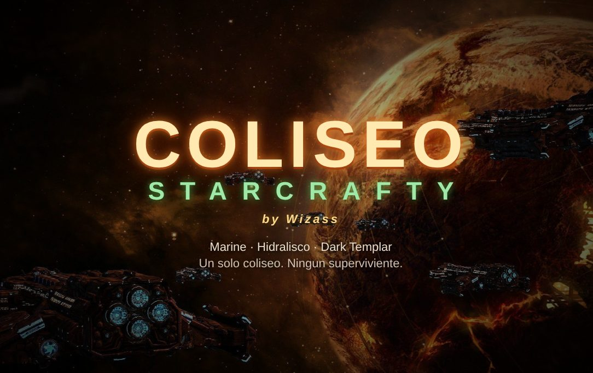
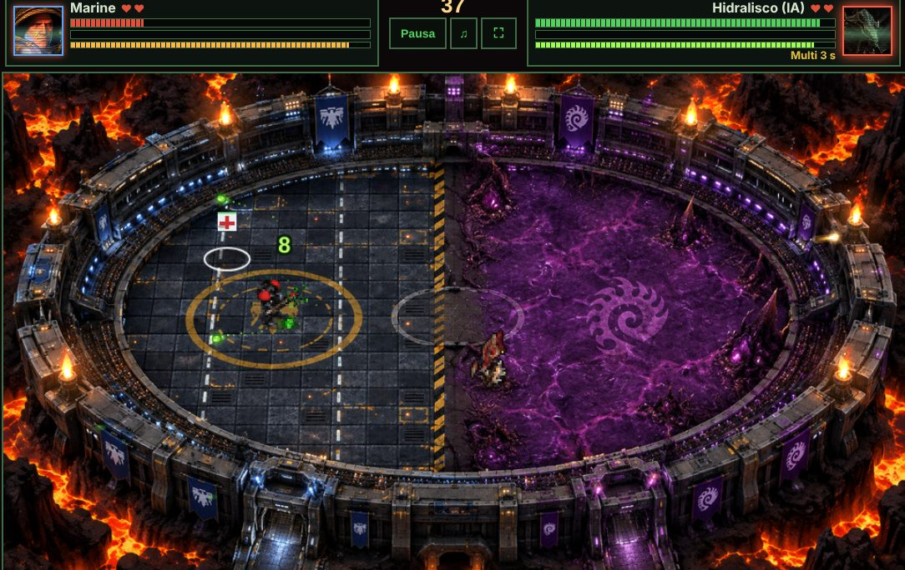
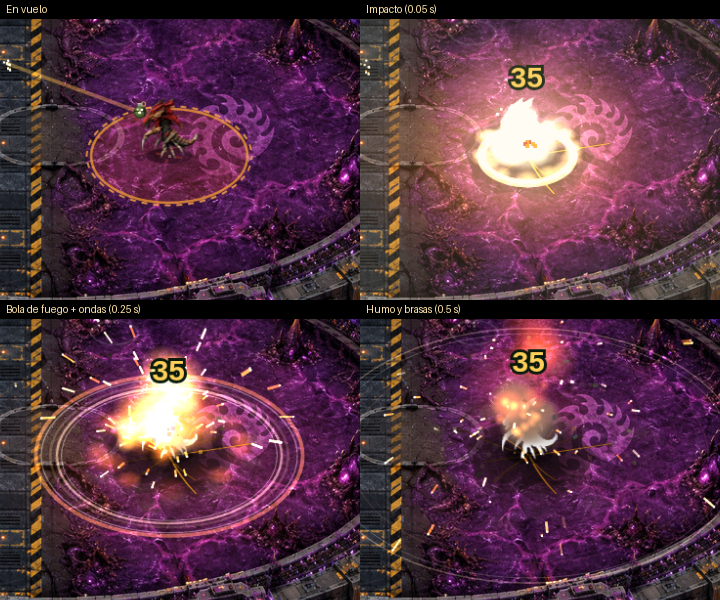

# Coliseo StarCrafty

Juego de lucha de arena para el navegador, ambientado en **StarCraft: Brood War**. Un Marine, un Hidralisco y un Dark Templar pelean dentro de un coliseo, solos contra la IA o de dos jugadores. Hecho con HTML, CSS y JavaScript puro, sin librerías ni instalación.

## ▶ Jugar ahora

**https://wizardjcp60-sketch.github.io/Proyecto-StarCrafty/**

Haz clic en la pantalla antes de esperar la música: los navegadores bloquean el sonido hasta el primer clic o tecla.





## Cómo se juega

- Cada luchador tiene **2 vidas** (configurable de 1 a 3) y cada ronda dura **45 segundos**.
- Si se acaba el tiempo, cae un **misil nuclear** sobre quien tenga menos vida.
- Caen objetos al azar: escudo, stimpack, botiquín, multidisparo y un zergling explosivo (un disparo lo detona).
- Dificultad de la IA: fácil, normal o difícil.

### Controles

| Acción | Teclado |
| --- | --- |
| Mover | `W` `A` `S` `D` o flechas |
| Disparar | `F` o `Espacio` |
| Pausa | `Enter` |
| Especial (se recarga cada 9 s) | `G` lanza la granada del Marine, `.` escupe el ácido del Hidralisco |

- **2 jugadores:** el Marine usa `WASD` + `F`; el Hidralisco usa las flechas + `Shift` derecho.
- **Dark Templar:** pelea cuerpo a cuerpo, va camuflado (los disparos contra él se desvían hasta que ataca) y su especial es un salto sombrío que lo hace reaparecer detrás del rival.
- **Mando:** stick o cruceta para mover, `A` o gatillo para disparar, `X` o `B` para el especial, `Start` para pausar.
- **Móvil:** salen controles táctiles (mejor en horizontal).



## Jugar en tu ordenador

Descarga el repositorio (botón verde **Code → Download ZIP**), descomprímelo y abre `index.html` en Chrome, Edge o Firefox. No necesita servidor.

## Estructura

```
index.html        Página principal (HUD, menú, pausa y canvas)
css/              Estilos
js/               config.js (ajustes y rutas), audio.js, granada_fx.js, game.js
assets/           Imágenes, sonidos, voces y música
tools/            Scripts de Python que generan atlas, efectos y sonidos
docs/             Capturas para este README
LEEME.txt         Documentación completa del proyecto (en español)
```

Los ajustes de balance están en `js/config.js`. El detalle de cada sistema está en [`LEEME.txt`](LEEME.txt).

## Créditos y aviso

Proyecto de aficionado, sin fines comerciales y sin relación con Blizzard Entertainment. *StarCraft*, *Brood War* y sus personajes, imágenes, voces y música son propiedad de Blizzard Entertainment.

- Hoja de sprites del Marine ("Terran Marine"): extraída por Colton.
- Hojas del Hidralisco y del Dark Templar: ACE_Spark.
- La música de fondo (`arena.mp3`) es el "Main Title" de StarCraft Remastered. Si quieres publicar tu propia versión, reemplázala por una pista tuya con el mismo nombre.

Si vas a redistribuir el proyecto, revisa antes los derechos de las imágenes, voces y música.
